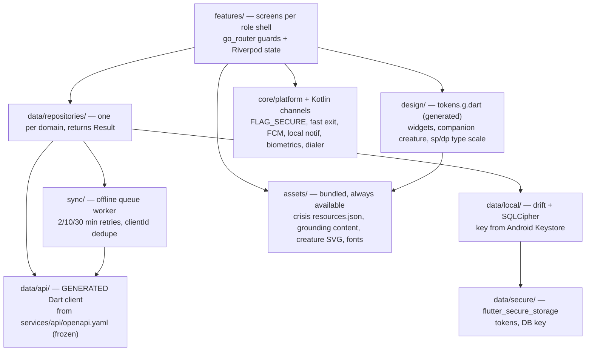
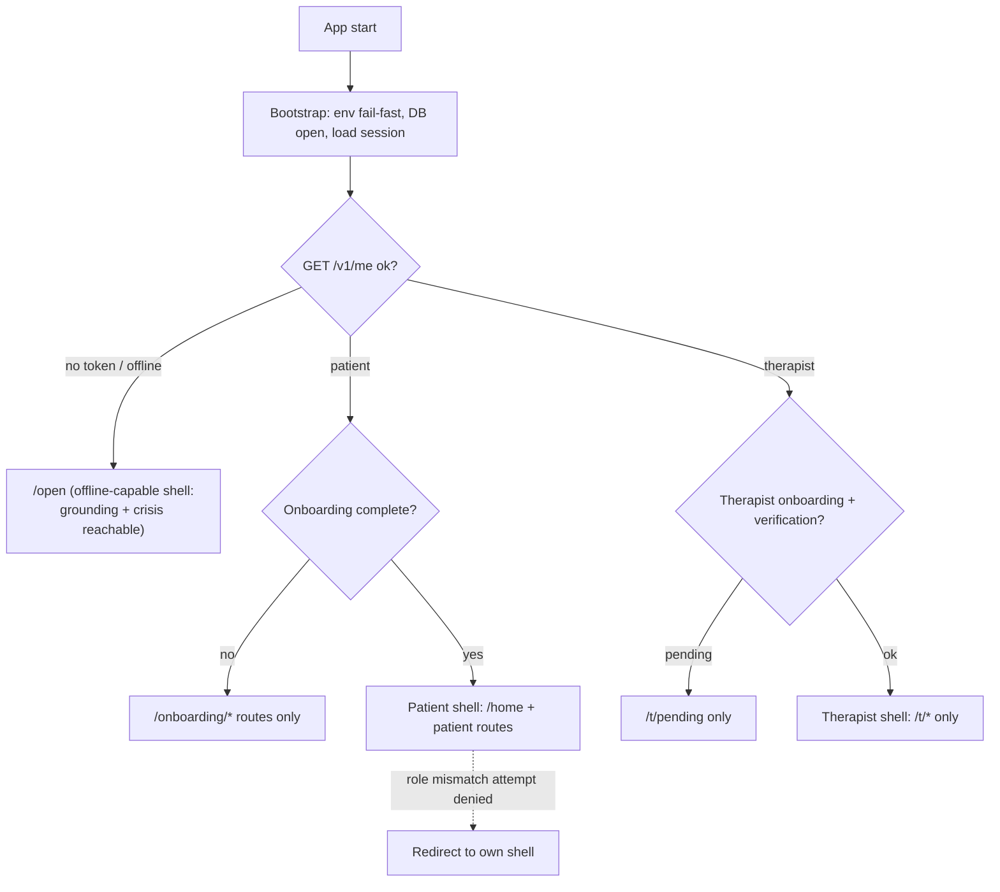
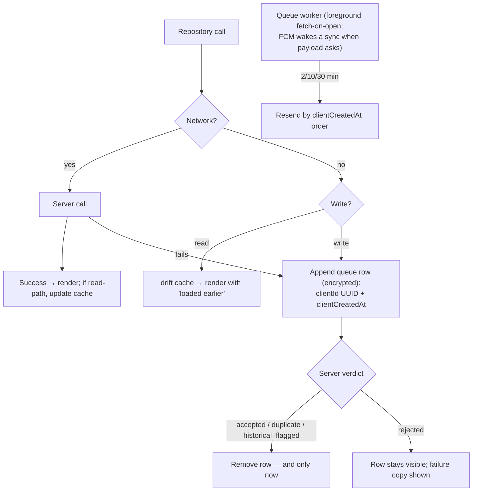

# Solace — App Architecture

> Frontend architecture for `apps/mobile` (Flutter 3.47, Android 24–36). Companion to `apps/mobile/docs/requirements.md` and `docs/plan-frontend.md`. ADRs live in `docs/plan-frontend.md` (F-ADR-1..10).

## Layers

Rules the diagram encodes:

1. **`design/` is generated.** `tokens.g.dart` builds from `packages/design-tokens/tokens.json` (DTCG). Nothing in `lib/` hard-codes a colour, radius or duration (the three format exceptions: `gutter`, `ease-entrance`, `duration-fast`).
2. **`data/api/` is generated.** Pin the generator version (FD-1). Regeneration in CI must produce zero diff.
3. **Screens talk to repositories, never to the DTO client.** Repositories return `Result` (Success/Failure) so screens can render the four states without knowing transport details.
4. **`sync/` is the only writer that deletes queue rows** — on server `accepted`/`duplicate`/`historical_flagged` confirmation.
5. **Therapist data never reaches `DB`.** Therapist repositories are memory-only (FD-9); a schema test asserts no patient-data table for the therapist domain.

## Router and role guard

- Source of role: one endpoint, never the UI (FD-10). Guard is a `go_router` redirect tested in both directions before any therapist screen exists.
- Logging out clears DB, tokens, role state; route returns to `/open`.
- `/crisis`, `/grounding/*`, `/open` are reachable from **every** shell, from the biometric-lock overlay, and with no session.

## Offline decision flow

- Freshness classification (which queued items are "historical") is the server's (spec 11.6). The client supplies `clientCreatedAt` plus a monotonic-offset skew measurement (FD-5) and renders the verdict it receives.
- Crisis **screen** never enters this flow: it reads only `assets/` + the local read-only cache, offline, no login (REQ-APP-CRISIS-01).

## What runs without any of the above

`assets/` (crisis numbers + verification dates, grounding content) plus `FLAG_SECURE` and the dialer via the Kotlin channel. No DB, no token, no network needed. This is the Floor: if everything else fails to initialise, it must still open.

## Platform channel map (Kotlin)

| Capability | Where | Failure behaviour |
|---|---|---|
| `FLAG_SECURE` | per-screen call through the channel | redacted log + CI test failure (screen still works) |
| Fast exit | `finishAndRemoveTask` | if the call fails, the app still finishes; recents-clearing is the reported gap |
| FCM | device registration + neutral payload parsing | fetch-on-open fallback |
| Local notifications | channel creation (crisis=SECRET, care_reminders, connection) | server state still shown on next open |
| Biometrics | `local_auth` binding | passcode fallback; never "no lock" |
| Keystore | DB key + token storage | re-sign-in; never plain storage |
