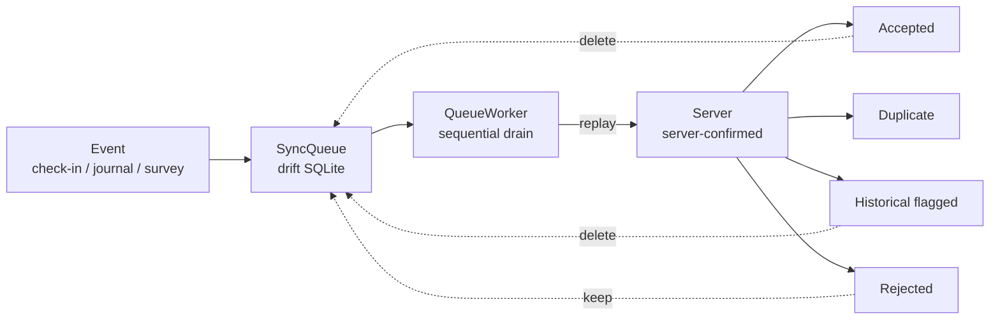

# Solace — Offline Capabilities (spec §12.1)

What works offline, what does not, and how the queue handles it.

## Offline-Capable Paths (spec §12.2 — "Always available")

| Feature | Offline behavior | Persistence |
|---|---|---|
| Crisis screen numbers + `999` / `Kaan Pete Roi` | Shown from bundled assets; numbers never placeholder | Bundled `assets/crisis/resources.json` |
| Crisis resources (`grounding.json`, crisis resources) | Load from assets on app start; no DB needed | Bundled assets |
| Grounding techniques | Full content from assets | Bundled `assets/grounding/*.json` |
| Personal Journal draft | Saved to drift-backed `JournalDrafts`; synced when online | Drift SQLite (SQLCipher) |
| Restriction levels | Offline display of active restriction | Drift |
| Consent records | Offline read of stored consent | Drift |
| Check-in survey responses | Queued in `SyncQueue` locally; replayed on reconnect | Drift SQLite |
| Alerts view | Reloaded via `GET /alerts` when online; empty shell otherwise | Server-side only |
| Safety plan view/edit | Edit while offline written to DB then synced | Drift + server confirm |

## Online-Required Paths (spec §12.3 — "Not available without connectivity")

| Feature | Offline behavior |
|---|---|
| Home screen full data (patient list, last activity) | Shows cached last known state + offline banner |
| Server-ordered patient list | Cached local order only |
| Invite acceptance (withdrawal, declined invite hiding data) | Requires server |
| Therapist alert content flow | Requires server |
| AI summary note (therapist-facing) | Server response required |
| Real-time WebSocket push | FCM push + fetch-on-open only (Phase 6 deferred) |

## Queue & Sync

The `QueueWorker` drains rows in `clientCreatedAt` order:
- **Sequential** drain — one request at a time; never parallel.
- **Crash safe** — retries from row state; no partial writes.
- **Retry schedule:** 2 / 10 / 30 min, capped at 30 attempts.
  - Exceed 30 → remaining dropped (logged).
  - Server returns `historical_flagged` → deleted.
  - Server returns `rejected` → kept for therapist report (retry later).
  - Conflict flag set on skew ≥ clock-skew threshold (FD-5).
- **Dedupe** by `clientId`: same payload acknowledged only once.
- **Persistence**: SQLite-backed queue store in `data/local/`.

