# Trauma Recovery Companion App — Complete Project Specification

**Version:** Consolidated build specification
**Built from:** the original project document + Issues 01–39 + Build Issues B01–B10 + Build Notes 01–12
**Rule used when sources disagree:** later team decisions replace the original spec. Every place where sources still conflict is listed in [Section 22](#22-open-items-and-unresolved-conflicts) instead of being silently picked.

> Not a clinical or legal conclusion. Clinical content, regulatory position and Bangladesh-specific fit still require external review (see Section 22).

---

## Contents

1. [Vision and positioning](#1-vision-and-positioning)
2. [Users, age range and launch scope](#2-users-age-range-and-launch-scope)
3. [System at a glance](#3-system-at-a-glance)
4. [Clinical foundation](#4-clinical-foundation)
5. [The AI layer](#5-the-ai-layer)
6. [Patient experience](#6-patient-experience)
7. [Safety plan](#7-safety-plan)
8. [Therapist connection and verification](#8-therapist-connection-and-verification)
9. [Therapist experience](#9-therapist-experience)
10. [Restricted access and the fallback path](#10-restricted-access-and-the-fallback-path)
11. [Crisis system](#11-crisis-system)
12. [Offline mode](#12-offline-mode)
13. [Device safeguarding](#13-device-safeguarding)
14. [Privacy, consent and data](#14-privacy-consent-and-data)
15. [Security and authentication](#15-security-and-authentication)
16. [Technology stack](#16-technology-stack)
17. [Information architecture](#17-information-architecture)
18. [Success measures and evidence gates](#18-success-measures-and-evidence-gates)
19. [Build plan and gates](#19-build-plan-and-gates)
20. [Regulatory position and business model](#20-regulatory-position-and-business-model)
21. [Permanent decisions](#21-permanent-decisions)
22. [Open items and unresolved conflicts](#22-open-items-and-unresolved-conflicts)

---

## 1. Vision and positioning

A trauma recovery **companion** that helps people work on their healing **between therapy sessions**. It combines validated clinical surveys, a professionally sourced task library, AI-driven personalisation and a therapist supervision layer.

> **Pitch:** *"Your therapist works with you once a week. We work with you every day."*

### What the app is not

- Not a standalone mental health treatment
- Not a diagnostic tool
- Not a replacement for licensed clinical care
- Not a crisis intervention service (it has a defined crisis protocol, but it is a safety net, not a service)
- Not a therapist marketplace (permanent — no matching, filtering or contact facilitation)

The app fills the gap between sessions; it does not replace what happens inside them. This is stated at every meaningful touchpoint: onboarding, Friday reflection, "too hard" tasks, persistently low mood, and a permanent note in Settings.

### Guiding principles

| Principle | What it means in practice |
|---|---|
| **Companion, never replacement** | Features that need clinical containment (Stage 2) require a connected therapist. |
| **Safety is never gated** | Crisis resources and basic grounding tools are available at every restriction level, offline, and without login. |
| **Say what is true** | Never tell a patient "someone was notified" unless that is verified. Label a displayed number differently from a completed handoff. |
| **The patient controls their data** | One simple privacy setting, a readable access history, patient-only disconnection. |
| **Warm to patients, direct to clinicians** | Two separate notification voices that must never mix. |
| **Protective, not punitive** | Restrictions are explained in advance and worded with care. |
| **Build the safety core first** | Crisis, consent and privacy decisions are hard to fix later; they are built and proven before anything else. |

---

## 2. Users, age range and launch scope

### Patients

- **Primary age range: 18–35.** This is a conscious, stated choice. Accessibility basics (font sizing, contrast, simple navigation) are included so people outside this range are not shut out.
- **Under 18: hard block at launch.** Parental consent, shared-device safety and safeguarding obligations are too large for a first build. The signup age confirmation therefore reads **"I am 18 or older"** (the original spec said 16 — superseded; see Section 22).
- **Severity:** the app routes by survey result. For the competition/demo build, all severity levels are supported through the restriction system. For real users after the competition, launch to **mild-to-moderate users first**; severe users are redirected to professional resources immediately rather than entering the restriction system. Severe users are added in v2 once the core loop is validated.

### Therapists

Licensed mental health professionals, **invited by an existing patient**. The therapist–patient relationship must already exist before the invite is sent. There is no open therapist signup.

### First release slice

| Surface | Launch scope |
|---|---|
| Patient app | **Android only** (largest user base in Bangladesh; easiest to sideload for early testing) |
| Therapist surface | Next.js web app (unavoidable — therapists need a dashboard) |
| Backend | One shared NestJS backend |
| Later patient platforms | iOS second, then desktop — only after crisis alert delivery, offline recovery, encryption and consent transitions are proven on Android |

The **patient app is the primary product**. The therapist dashboard is secondary and deliberately minimal in the MVP.

---

## 3. System at a glance

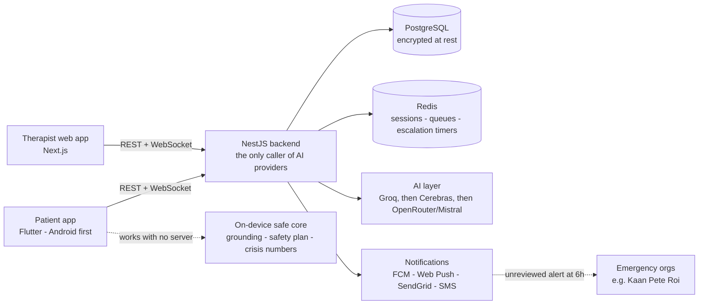

### The patient journey in one picture

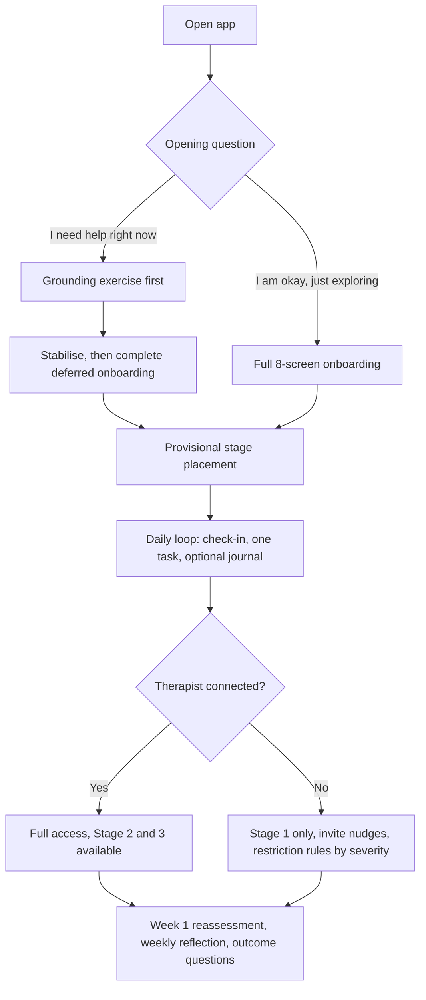

---

## 4. Clinical foundation

### 4.1 Validated survey tools (public domain)

Used at intake and suggested for periodic retakes: **PCL-5** (primary trauma screen), **PHQ-9** (depression), **GAD-7** (optional, secondary), **IES-R** (trauma-specific impact).

- Patients see results in **plain language, never raw clinical scores**. Connected therapists see the full results.
- Retake is available in Settings after a **14-day cooldown** (results are appended, not overwritten).
- **Placement is provisional** (see 6.2): a survey taken during an unusually bad week must not lock someone into a stage.

### 4.2 Recovery stage model

Based on Dr. Judith Herman's three-phase framework. Recovery is not linear; the app never assumes forward momentum.

| Stage | Name | Focus |
|---|---|---|
| 1 | Safety and Stabilisation | Nervous system regulation, routine, grounding |
| 2 | Remembrance and Processing | Gentle trauma processing, emotion work |
| 3 | Reconnection | Social re-engagement, meaning-making, growth |

**Stages are internal.** They exist for AI sequencing and for the therapist's view. The patient does **not** see a stage indicator or any announcement of a stage change (so stepping back never feels like failure). The patient simply sees their tasks for the day.

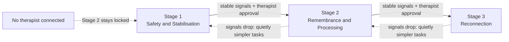

### 4.3 Task library

Curated from professional guidelines — **not AI-generated**. Sources: SAMHSA TIP 57, VA National Center for PTSD (PTSD Coach materials), ISTSS treatment guidelines, APA trauma guidelines, and CPT / PE task structures. The AI selects and sequences; it never invents tasks.

| Stage | Example tasks |
|---|---|
| **1 — Safety** | Box breathing, diaphragmatic breathing, 5-4-3-2-1 grounding, body scan, sleep routine, safe-environment exercises |
| **2 — Processing** | Hybrid journaling, emotion naming, trigger identification and logging, light movement, progressive muscle relaxation |
| **3 — Reconnection** | Real-world social reconnection (e.g. "Reach out to one trusted person this week", "Reconnect with someone you've been meaning to contact", "Spend time with someone who makes you feel safe"), values-based activity, gratitude and meaning prompts, small goal setting |

**Categories** (cut across stages): Breathing, Movement, Journaling, Grounding, Social, Cognitive, Creative. Patients pick preferred categories at onboarding.

**Safeguards around processing tasks**
- Stage 2 tasks unlock **only when a therapist is connected**, regardless of mood stability or time on the app.
- Every processing task ends with a **grounding check-out** ("How are you feeling now?") with crisis resources always visible.
- "Peer support exploration" no longer exists as a task. It was replaced by real-world reconnection tasks; the app has **no in-app peer community, ever**.

### 4.4 Clinical governance of the library

- **One named licensed therapist** is the clinical reviewer for v1 of the library.
- **Documented sign-off** (not just a conversation) covering: which tasks, which stage assignments, which eligibility rules.
- **Removal process:** flag → pause → return to the reviewer → reinstate only after sign-off.
- **Status: the reviewer is not yet confirmed** (open item, Section 22).

---

## 5. The AI layer

### 5.1 Core principle

**The AI is a librarian, not a doctor.** It selects from the pre-approved library based on patient signals. It does not prescribe, diagnose or generate clinical content.

### 5.2 Input signals

1. **Initial survey results** — provisional stage placement and severity routing.
2. **Daily check-in** (under 60 seconds): mood (1–10 with feeling words), body signal (Tense / Tired / Restless / Calm / Heavy), and a task reflection (did you complete yesterday's task; if not, what got in the way).
3. **Recovery Journal sentiment** — a passive background scan for emotional tone and crisis language (see 6.6 for which journals this covers).
4. **Skip reasons** — for unconnected users, a one-tap reason ("I was busy" / "I didn't feel like it" / "I wasn't doing well") so absence is not automatically read as regression.
5. **Outcome signals** — the post-task "Did this help?" tap and weekly outcome questions (Section 18).

### 5.3 Sequencing rules

| # | Rule |
|---|---|
| 1 | **Never advance a stage on time alone.** All three must hold: mood average stable or improving over 7 days, task completion above 60% over 7 days, no crisis language in the journal that week. |
| 2 | **Quietly simplify when signals drop.** Three consecutive low-mood days or three skipped tasks lead to simpler tasks (no announcement) and the therapist invite resurfaces. **Inactivity itself does not step the patient back** — it notifies the therapist (see Rule 6). |
| 3 | **One primary task per day** plus one optional supplementary task. One swap per day is allowed via "I need something different today" (see 6.4). |
| 4 | **Friday offers a light optional task first, then an optional weekly reflection** — reflection no longer replaces the task. |
| 5 | **Stage advancement needs therapist approval** when a therapist is connected. The AI holds the recommendation for 48 hours pending review. |
| 6 | **Inactivity → therapist outreach.** The therapist is notified and checks in. If the patient is fine, the therapist logs it and the app **reduces task frequency** instead of stepping back. |
| 7 | **New categories need consent** (see 6.4); one new category at a time, additive only. |

### 5.4 What the AI never does

- Interpret a trauma narrative and reflect it back as psychological insight
- Tell a patient *why* they feel what they feel
- Suggest or validate a diagnosis
- Recommend stopping or changing medication
- Make clinical progress assessments
- Handle a crisis conversationally
- Touch the safety plan in any form (no suggestions, rewriting, sentiment analysis or crisis flagging)
- Auto-send anything to patients on a therapist's behalf

### 5.5 Transparency

Every task card has a **"Why this task?"** link: the AI explains the selection in plain terms (current stage, recent signals, why it fits). No black box.

### 5.6 Crisis detection inside the AI layer

- **False-positive buffer.** Trauma survivors often write about the past in present tense. Ambiguous signals are sent to the connected therapist as a **"possible concern"** before any Tier 2 or Tier 3 escalation. Only unambiguous, explicit crisis language bypasses the buffer and triggers automatic Tier 3.
- With **no therapist**, the buffer is skipped and the AI applies tighter, intent-specific thresholds.
- **Failure mode (B02):** journals **always save**, even if the AI endpoint is down or slow. A failed or timed-out scan is queued and run when the endpoint recovers. Failed analyses are flagged internally to a safety-team dashboard so a human can decide on manual review. **Patients are not told about degraded monitoring by the app** (that conversation belongs to the therapist).
- **Duplicate protection:** every entry gets a unique ID at creation. Before analysis, the system checks whether that ID already has a completed result; if so it skips. A retry can never produce a duplicate alert.
- **Latency target:** crisis detection has its own dedicated endpoint with a sub-2-second target.

### 5.7 Provider decision (locked — B03)

| Role | Provider |
|---|---|
| **Primary** | Groq (Llama 3.x) — fast, free tier, LPU inference meets the sub-2-second requirement |
| **Fallback 1** | Cerebras (also LPU-based, low latency) |
| **Fallback 2** | OpenRouter (Mistral) — last resort, extra routing layer |
| **Never** | OpenAI (permanently off the list — paid, not an option) |

- **All AI calls go through the backend only.** The Flutter app and Next.js dashboard never call a provider directly, so provider swaps never touch client code and are invisible to patients.
- **No specialised medical LLM** (MedAlpaca, ClinicalBERT etc.) as the conversational layer — none have passed safety benchmarks for patient interaction; a tightly engineered system prompt with guardrails and mandatory crisis triggers is the chosen approach.
- **Prototype phase: synthetic/fake data only.** No real patient data touches any provider until a compliant DPA is signed (Section 14.6).

### 5.8 AI logging (B07)

Raw journal text **never** enters AI logs. The log stores metadata only: entry ID, analysis timestamp, provider used, sentiment signal (positive / neutral / negative / crisis), whether crisis language was detected, duration in ms, and status (succeeded / failed / queued). The entry ID points back to the main database; when a patient deletes their account the journal is deleted and the log row becomes an ID pointing to nothing.

---

## 6. Patient experience

### 6.1 Onboarding

A single opening question decides the path. Onboarding is **postponed, never skipped**: someone who asks for help first must complete the full flow before reaching the full app.

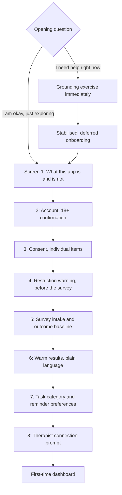

| Screen | What happens | Key edge cases |
|---|---|---|
| **1 Welcome** | Plain-language description of what the app is and is not. Crisis resources visible before anything else. | — |
| **2 Account** | Email, password, **"I am 18 or older"** checkbox. No name collected yet. | Under 18 → hard-stop screen, age-appropriate resources, no account created. |
| **3 Consent** | Individual toggles with expandable "What does this mean?" (see 14.2). | Required items snap back on if toggled off. Progress saved if the app closes. |
| **4 Restriction warning** | Plain-language explanation of the three restriction levels, stated **before** the survey: crisis resources and grounding are never restricted; restrictions protect, not punish. | Back returns to Screen 3 with consents preserved. |
| **5 Survey** | PCL-5, PHQ-9, GAD-7 (if opted in), IES-R; one question per screen; no scores shown. A single **outcome baseline question** is asked once for later before/after comparison. | A self-harm item (PHQ-9 Q9 or PCL-5) triggers a soft check-in overlay immediately after that question. Progress saved per question. Abandoned after PCL-5 → partial results usable (flagged to therapist). |
| **6 Warm results** | Optional first name, plain-language summary, starting focus. **Placement is shown as provisional**: "your starting point will adjust as the app learns more about you." | Retake only via Settings after 14 days. |
| **7 Preferences** | Task categories (multi-select), reminder time (default 9:00). | None selected → balanced spread. |
| **8 Therapist connection** | Email invite or therapist code, or "I'll do this later" (clearly visible). | Skipping shows one plain-language confirmation of what happens next. |
| **First-time dashboard** | State varies by therapist/severity; one tooltip on Today's Focus, shown once. | No task available → grounding task shown. |

**Disclosures made once, during onboarding, in plain language:**
- *Crisis scanning:* "No matter your privacy setting, the app always watches for safety signals. This cannot be turned off."
- *Revoking access:* "Once your therapist has viewed something, revoking access prevents future viewing but cannot remove what they have already seen."
- *External AI:* "To personalize your experience, some journal content is analyzed by an external AI service. This service cannot retain or use your data for any other purpose."

### 6.2 Provisional placement

- The first survey gets the patient in the door; the **first week of behaviour determines where they actually start.**
- After **7 days** of mood check-ins and task interaction, the AI reassesses and quietly adjusts if needed.
- **Partial or unclear results default to lower-severity routing**, not higher.

### 6.3 Dashboard (home screen)

One dominant element; everything else is subordinate.

| Priority | Element |
|---|---|
| 1 (loudest) | **Today's Focus** — one task: name, one-line description, time estimate, category icon, **Start** button, "Why this task?" link. Large, warm colour. |
| 2 | **Mood check-in** — emoji scale with feeling words, about 10 seconds, above the fold. |
| 3 | **Crisis button** — persistent, always visible, visually quiet, bottom corner. |
| Below the fold | Weekly snapshot (7-day mood and task completion, no gamification), therapist panel (connection status / invite button), Day-1 safety plan card. |

**Removed or avoided:** the visible recovery stage indicator, recovery percentages, streak mechanics, urgent notification badges, raw clinical scores, competing feature lists.

**10-second test (required before launch):** sit someone outside the team in front of the home screen for 10 seconds and ask "What does this app want you to do right now?" The answer must be **"start today's task."**

### 6.4 Daily tasks and flexibility

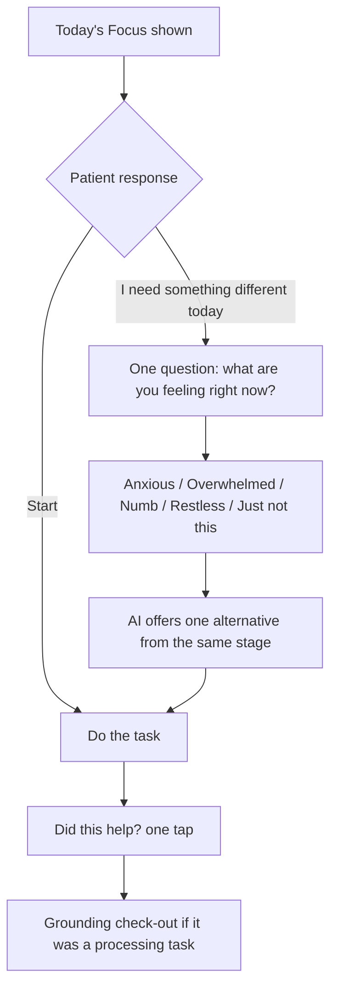

- **One swap per day**, maximum — protects therapeutic sequencing.
- **Friday:** a lighter, optional task from the preferred category first; then, when the patient is ready, the optional weekly reflection ("When you're ready, here's your weekly reflection."). Both are independently skippable. The reflection day is configurable; Friday is the default.
- **Unfamiliar categories:** before any new category appears the patient gets a consent prompt — *"We think you might be ready to try something new — want to give it a go, or stick with what's working?"* with two visually equal options. **"Not yet"** defers one week. **"Yes"** unlocks the category. One new category at a time; preferred categories always remain available.
- A task marked **"too hard"** triggers an acknowledgement that some things are better worked through with a therapist.

### 6.5 Mood and weekly outcome questions

The daily check-in is three questions, under 60 seconds. The **weekly reflection** adds two outcome questions (see Section 18). The reflection also suggests sharing the week with a mental health professional.

### 6.6 Journals and privacy

Two completely separate journals, so the name "personal" always means what it says.

| | **Recovery Journal** | **Personal Journal** |
|---|---|---|
| Availability | Stage-gated | **Always available from day one** |
| Format | Structured prompts in Stage 1; hybrid (prompt as a starting point, free writing beyond it) in Stages 2–3 | Fully free writing |
| Therapist access | Per the patient's privacy setting; therapist can request more | **Never** |
| AI | Sentiment scanning and crisis scanning run here | No sentiment analysis, no personalisation (see the clarification below) |
| Restriction | Locked at Level 2+ (new entries only; history stays readable) | Not part of the restriction system |

> **Clarification needed before build:** the original decision for the Personal Journal says "no AI analysis", while the privacy wording says the app *"always watches for safety signals… regardless of your privacy setting."* The team must state explicitly whether safety-signal scanning applies to the Personal Journal. See Section 22.

**One unified privacy setting** (replaces the old three-level-plus-exceptions model). The system applies the underlying rules automatically:

| Patient sees | Therapist sees |
|---|---|
| **Keep it between us** (shown as "Hidden from therapist" — never "Private") | Nothing from the Recovery Journal |
| **Let my therapist see progress** (default) | AI sentiment summary and keywords |
| **Full access** | Raw Recovery Journal entries |

Point-of-choice wording, shown **before** the patient writes: *"Your therapist won't see this, but the app still scans for safety signals to protect you."*

**Journal-access requests.** A therapist may request an upgrade to full access. The patient sees: *"Your therapist would like to see more of your journal. This is completely your choice — there's no wrong answer."* Accept and Decline are **visually equal**. On decline, the therapist sees only "patient has kept current settings" — no reason, no flag.

**Monitoring OFF state.** The patient may withdraw crisis-monitoring consent later (Section 14.3). Monitoring and journal privacy cannot both be off at once.

### 6.7 Notifications

Two separate registers, never mixed: **patient reminders are warm and low-pressure; clinical alerts are clear and direct.**

**Patient tone rules:** address the person, not the behaviour ("How are you doing today?" not "You haven't checked in"); no guilt framing; never imply watching or tracking ("we noticed", "we detected"); under 10 words for push, under 30 for the body; always optional-feeling.

**Patient frequency rules**
- Maximum one reminder per type per day; no more than two patient-facing notifications in any 24 hours.
- Quiet hours 10pm–8am, always respected.
- All reminders suppressed once check-in and task are done for the day.
- During a Tier 2 or Tier 3 event, all non-crisis notifications are suppressed until the event is resolved.
- **"Not today" button.** Every non-crisis notification carries two lock-screen buttons — *Open app* and *Not today*. "Not today" pauses non-crisis reminders for 24 hours without opening the app. It never suppresses crisis or safety-critical notifications.
- Patients **cannot** disable crisis resource nudges or therapist-connection status notifications.
- **No streak notification.** The 7-day streak milestone was removed; encouragement is effort-based with no counts (e.g. *"You've been showing up for yourself lately."*).

**Lock-screen safety:** discreet by default (see Section 13).

| Notification | To | Register |
|---|---|---|
| Daily check-in / task reminder / Friday reflection | Patient | Warm, low urgency |
| Effort-based encouragement | Patient | Warm |
| Stage advancement pending | Patient | Warm |
| Therapist connected | Patient | Warm |
| Restriction level change | Patient | Warm and honest |
| Escalation shifting from therapist to organisation | Patient | Calm, direct |
| New AI summary generated | Patient | Neutral: "A new weekly summary is ready. Your therapist can see this based on your current settings." Once per summary, not per view |
| Crisis resource nudge (Tier 1) | Patient | Calm, grounding |
| New patient connected / weekly summary ready | Therapist | Neutral |
| Patient inactive (3+ days) | Therapist | Direct |
| Stage advancement awaiting approval (within 48h) | Therapist | Direct |
| Crisis alert Tier 2 / Tier 3 | Therapist | Direct, urgent — no quiet hours |
| Unreviewed crisis alert (6h) | Therapist | Direct, critical |

Crisis alerts to therapists go out on **all available channels simultaneously** (push, web push, email), never sequentially.

### 6.8 Messaging

A message thread per patient improves continuity between sessions. To prevent it being mistaken for live support:
- On first use the patient sees once: *"Messages are reviewed between sessions — for urgent support use the crisis button."*
- The **crisis button is always visible** on the messaging screen.
- The therapist chooses a typical response time at onboarding (within a few hours / within a day / within 2 days), shown on the thread: *"Your therapist typically replies within X hours."*
- AI drafts for the therapist are clearly labelled and need confirmation before sending (Section 9.4).

---

## 7. Safety plan

A short, **patient-authored** document: five fields in the patient's own words. It is not AI-generated, therapist-prescribed or a clinical assessment — a personal anchor written in a stable moment so it exists when things are not stable.

**Where it lives:** Settings → Safety Plan (create/edit, online) and the Crisis screen (read-only, **works offline**). It is introduced once on Day 1 ("One thing worth doing today"), reappears once on Day 3 if not done, then stays quietly in Settings. It is never required.

### 7.1 The five fields

| # | Prompt | Input |
|---|---|---|
| **1** | What helps, even a little, when things feel completely overwhelming? | Free text, 300 chars |
| **2** | Who are two people you could contact when things get hard? (people in your life, not services) | Two name + optional contact fields; at least one name required |
| **3** | What crisis line or service would you contact in an emergency? | Pre-filled with a locale-appropriate line; editable; **cannot be left empty** |
| **4** | What is one reason that matters to you — something that makes staying safe important? | Free text, 200 chars. **Never touched by AI; never shared with therapists.** |
| **5** | Is there somewhere — physical or in your mind — that feels safer? | Free text, 200 chars |

**Connected therapist auto-population.** A connected therapist's name and phone appear automatically as a read-only emergency contact below the patient's own contacts ("Your connected therapist — [Name]"), available offline. The therapist agrees to this role explicitly (8.4).

**Trusted-contact care.** The closest person is not always the safest. During creation the app says: *"This is for your reference only — choose someone you feel completely safe contacting."* The patient can **opt out of automatic contact** (Section 11.4) for unsafe home situations. **Location is never shared.**

### 7.2 Creation flow — progressive, not all-or-nothing

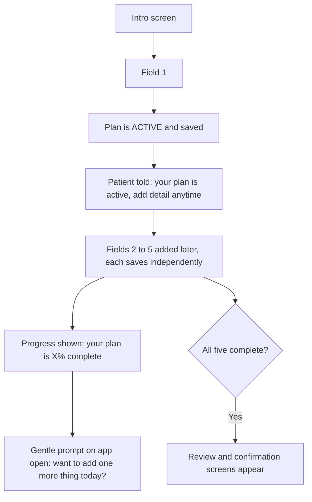

- **Field 1 alone creates a usable plan.** Fields 2–5 are enrichment. Review and confirmation appear only once all five are done.
- Exiting mid-flow saves a draft; the patient resumes where they stopped, with no guilt language ("Draft — tap to continue").
- The crisis screen shows whatever is filled; an incomplete plan never blocks access.
- Editing needs a connection (the offline copy is always the last saved version); saving overwrites; no version history.

### 7.3 Deletion and privacy

- **No one-tap "delete plan".** The patient clears fields individually. The editing screen explains why: *"We don't offer one-tap deletion because removing your plan in a difficult moment could remove something you'd want later. You can clear any field individually anytime."*
- **Private by default, permanently.** Binary choice: private (therapist cannot even see it exists) or **share with therapist** (read-only). Sharing is opt-in only; a therapist cannot request it. **Field 4 is always excluded** and shown to the therapist as "Personal — not shared."
- Stored encrypted server-side and on device. Not used for AI analysis, task selection, stage assessment or crisis flagging.

---

## 8. Therapist connection and verification

### 8.1 Connection flow — two gates before any data is visible

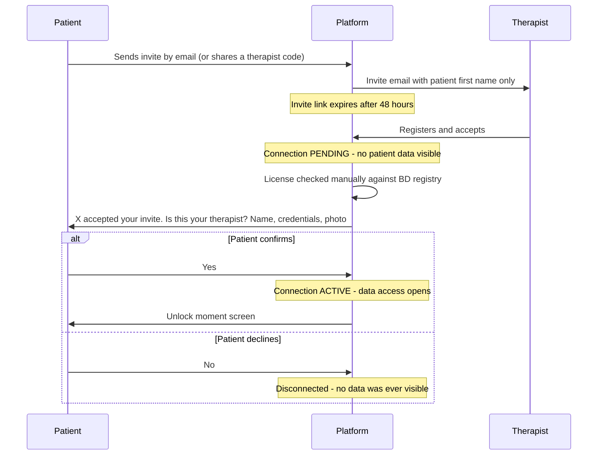

**Both gates must pass:** license verification (identity and professional status) **and** patient confirmation (right person). Neither substitutes for the other.

- **Patient-invite-only.** Direct therapist signup is not allowed.
- **Wrong connection:** reversible through the standard disconnection flow with an audit flag. A patient who later realises it was the wrong person can flag "I connected the wrong person", which creates an internal safety note.
- **Therapist code:** each therapist gets a code the patient can enter as a fallback. It follows the same pending state and both gates.
- **Unlock moment:** when the connection activates, the patient sees a transition screen that acknowledges what they did and confirms full access.

### 8.2 Verification and re-verification

| Rule | Detail |
|---|---|
| Initial check | Manual verification of the licence against the official BD registry during onboarding; the account stays **pending** until complete. |
| Cycle | Re-verify every **six months**. |
| Reminder | Automatic reminder **30 days** before expiry. |
| Grace | **14 days** after expiry before access is suspended. |
| Revoked licence | **Immediate suspension**, no grace period. |
| On suspension | Patient: "Your therapist connection is temporarily paused." Therapist: clear reinstatement instructions. |
| Collected at signup | Licence number, professional body, country of practice. |

### 8.3 When the therapy relationship ends

- **Patient-only disconnection.** A therapist cannot disconnect themselves.
- **Access ends immediately**, with no grace period and no lingering read access.
- The message thread is **kept for the patient** as their own record and disappears from the therapist's side immediately.
- Therapist notified: *"Your connection with this patient has ended. You no longer have access to their data."* No reason given.
- **One active therapist at a time.** Reconnecting requires going through the full process again.

### 8.4 Therapist's explicit consent to the emergency role

Included in the terms **and** called out in therapist onboarding with one line: *"By connecting with a patient, your contact will be added to their emergency safety plan."*

### 8.5 If the therapist does not respond

See Section 10.2 — the restriction timer pauses fairly and has a hard cap.

---

## 9. Therapist experience

### 9.1 Design philosophy and MVP scope

A clinical management tool, not a wellness product: fast, clear, efficient. It is **secondary** to the patient app. The **MVP therapist side is minimal**: enough to demonstrate the connection, receive and resolve alerts, and view AI summaries. The full clinical-management vision is post-MVP. *(The exact cut line is for the team to set; see Section 22.)*

### 9.2 Patient overview

Patients are sorted into priority groups:

| Group | Meaning |
|---|---|
| **Needs Attention** (red) | AI-flagged distress or acute crisis; alert type, last active, quick actions |
| **Check In When You Can** (yellow) | Mild drop in signals; last active and brief context |
| **Progressing Well** (green) | Compact cards: stage, mood trend, weekly task completion |
| **No recent activity** (separate) | Patients who have not checked in for X days appear as **unknown status**, never misread as low priority |

An explicit disclaimer on all AI output states that clinical judgment takes precedence. The therapist sees the stage; the patient does not.

### 9.3 Individual patient view

AI weekly summary (with disclaimer); 30-day mood chart; task completion and skip reasons; roadmap controls (add, modify, remove); stage lock and advance controls (therapist action required); journal view according to the patient's setting; safety plan read-only if shared (Field 4 hidden); survey scores; message thread; "request full access" button (journal only); inactivity outreach logging.

### 9.4 AI for therapists

**Does:** weekly summaries, a cross-patient concern feed, drafted task suggestions (approve / modify / reject), message drafts in the therapist's own style, session-prep prompts.
**Does not:** diagnose, override decisions, suggest medication changes, or auto-send anything.

**Draft rules:** visually distinct "AI Draft" state; therapist must review and confirm; references specific patient data; permanent, non-dismissible note: *"AI drafts are suggestions only. You know your patient. Review carefully before sending."*

### 9.5 Therapist onboarding

1. What the platform is and is not
2. Account creation with licence number, professional body, country
3. **Data Sharing Agreement** (separate from ToS; they act as partial data controllers; must accept before any patient data)
4. **Crisis alert responsibilities** (three tiers, escalation timer, what an unreviewed 6-hour alert means for their account) with an acknowledgement checkbox
5. How the AI works and where it stops
6. First-time dashboard (empty state shows their code, or a pending patient)

Also during onboarding: the explicit emergency-contact statement (8.4) and the **typical response time** selection (6.8).

### 9.6 Accountability for alerts

Therapist duty is to **respond when available**. The platform owns the safety net: the 6-hour escalation to emergency organisations *is* the coverage model, so a therapist's non-response is not left as the only protection. *(This legal reading is awaiting mentor confirmation — Section 22.)* A therapist who consistently fails to respond is treated as a platform safety problem. Crisis alert notifications cannot be disabled.

---

## 10. Restricted access and the fallback path

Restriction is **protective, not punitive**, and the patient is told about it before the survey.

### 10.1 Who is restricted

| Survey result | Therapist | Restriction |
|---|---|---|
| Mild | None | None — gentle encouragement |
| Moderate | None | Softer version of the levels below, stretched timelines |
| Severe | None | Full progressive restriction |
| Any | Connected | None |

### 10.2 Who controls the timer

The restriction timer only counts against what the **patient controls**.

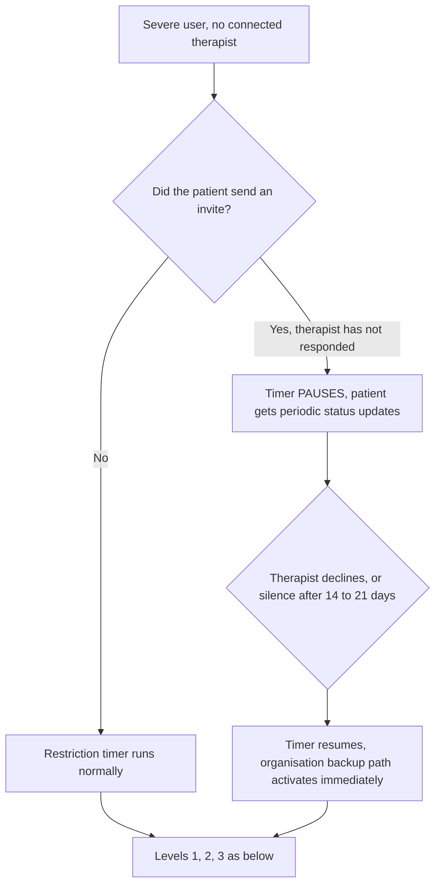

The pause is **capped at 14–21 days** to prevent gaming.

### 10.3 The levels

| Level | When | What changes |
|---|---|---|
| **1** | Days 1–14 | Full access; library limited to Stage 1; persistent therapist-invite banner; Day-7 dismissible reminder; more conservative AI tone. **Multiple reminders appear before any restriction begins.** |
| **2** | Days 15–30 | Mood check-in, Stage 1 grounding and breathing, crisis resources, invite stay open. **No new journal entries, roadmap changes or detailed progress.** The copy acknowledges that cost and access may be real barriers and links to free and low-cost options. |
| **3** | Day 31+ | Always accessible: mood check-in, crisis resources, grounding toolkit, therapist invite. The home screen becomes a warm, direct letter that pivots to **basic organisation numbers and crisis resources** — nothing more. |

**Access is locked, never erased.** Existing journals, roadmap and progress remain **fully readable**; only new entries are prevented.

**Never gated at any level:** crisis resources and basic grounding tools (breathing, 5-4-3-2-1).

### 10.4 Level 3 stays honest — and stays out of the marketplace business

- Message: *"We work best alongside a therapist. Here are organizations that can help you find support."*
- **No provider filtering, matching or contact facilitation.** That would turn the app into the marketplace it permanently refuses to be.
- **Post-MVP idea:** a verified organisation connection may count as the unlock condition in place of a therapist (planned expansion, not in the first build).

### 10.5 Organisation resources must be real and current (Build Note 4)

- Wording is precise: **"Here is a number you can call right now"** — never "we have notified someone."
- Every resource shows a **last-verified date** ("Verified March 2026") and **operating hours** before the patient tries to call.
- Each resource has a **named internal owner** and a **quarterly** re-verification.
- The **device dialer** is always kept as the ultimate fallback.
- Before build, confirm each organisation accepts inbound SMS (the 6-hour auto-SMS depends on it); otherwise use a dialer pre-filled with the hotline.

---

## 11. Crisis system

### 11.1 Consent comes first

Before the survey, patients read and agree to a plain-language explanation of how crisis detection works, including when automatic therapist contact happens. Consent is established **before** any crisis, not during one.

### 11.2 Three tiers

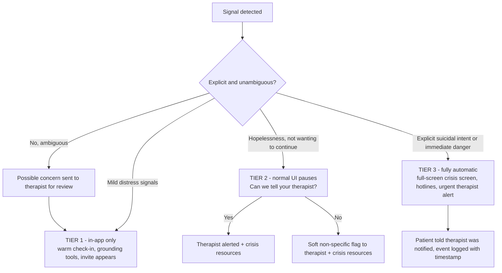

| Tier | Triggers | Response with a therapist | Response without a therapist |
|---|---|---|---|
| **1 — Mild distress** | Significant mood drop, negative sentiment trend, avoidance over several days. No explicit crisis language. | In-app check-in, grounding resurfaces, no external contact. | Same, plus therapist invite gently appears. |
| **2 — Moderate** | Explicit hopelessness, not wanting to continue, language past a defined threshold; not an immediate-danger signal. | Prompt: "We'd like to let your therapist know. Is that okay?" Yes → immediate alert. No → no detail shared, therapist gets a soft flag ("your patient may benefit from a check-in soon"). Resources shown regardless. | The consent prompt routes to crisis resources and the therapist finder instead. |
| **3 — Acute** | Explicit suicidal ideation, self-harm intent, immediate-danger language. Unambiguous threshold only. | Fully automatic — no consent prompt. Full-screen crisis screen, hotlines, urgent therapist alert, patient told. | Full crisis screen and hotlines; urgent therapist invite one tap away; organisations contacted (11.5). |

### 11.3 Escalation timeline

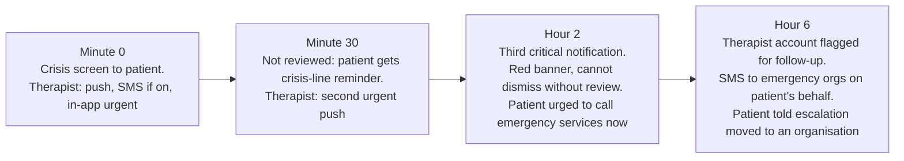

- The therapist always sees the elapsed time on the alert card.
- **Patient transparency (Issue 06):** when escalation shifts from therapist to organisation, the patient is told, so they are never left waiting with a false expectation of a therapist reply.
- If an organisation does not accept SMS, a dialer pre-filled with the hotline is the fallback.

### 11.4 Trusted contact (Build Note 5)

- **Tier 2:** never auto-contacted. The patient is asked in real time: *"Would you like us to reach out to your trusted contact?"* Yes or no.
- **Tier 3:** only as a **last resort**, after therapist **and** organisation escalation have both been attempted, an automatic **neutral** message goes out: *"Someone who cares about you wanted you to check in on them today."* No clinical detail, no crisis language.
- Patients can **opt out** of automatic contact while creating their safety plan.
- **No location sharing, ever.**

### 11.5 Alert lifecycle (B01)

"Generated", "sent", "opened" and "resolved" are different events. A mistaken click must never stop escalation while the patient is told help was notified.

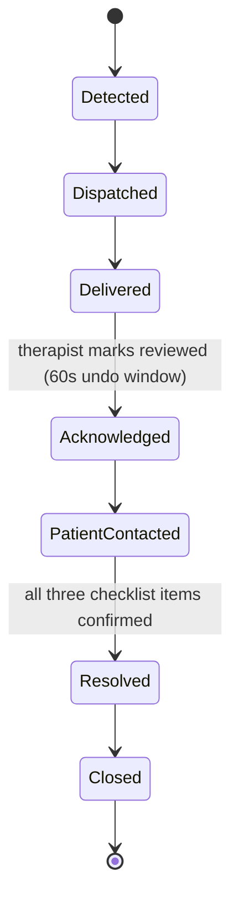

- **Resolving needs a checklist, not one click.** All three must be ticked: *I spoke with the patient* · *Patient confirmed they are currently safe* · *Follow-up plan is in place*.
- **"Mark as reviewed" is reversible** for 60 seconds before it takes effect.
- **State persists in the database.** A server restart resumes the alert exactly where it was.
- **No therapist:** after Tier 3 fires and organisations (e.g. Kaan Pete Roi) are contacted, the alert **auto-closes after 24 hours** with a note that it was escalated externally (the app cannot verify the conversation happened, so time-based closure is the practical fallback).
- Crisis alert views show: patient name, elapsed time, what triggered it (without reproducing private content), recent mood data, recommended actions, quick actions (message / view profile / mark reviewed) and a "does not replace clinical judgment" notice.

### 11.6 Late and duplicate alerts from offline writing (B04 / Build Note 6)

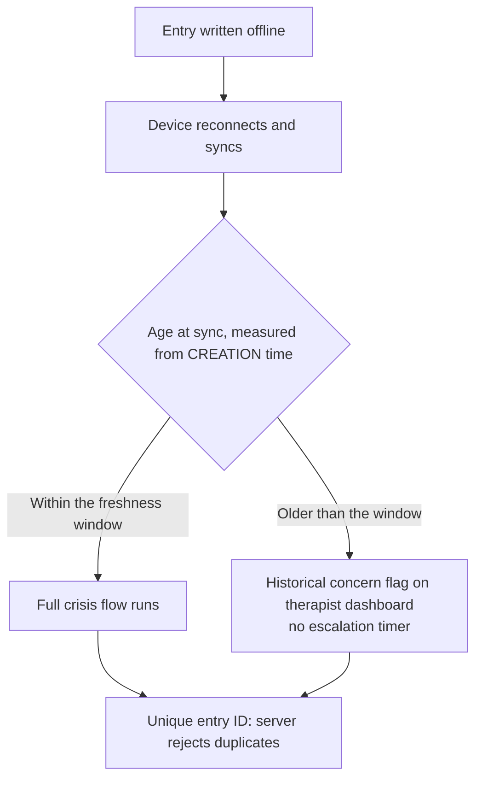

- **Creation timestamp** is always used, never the sync time.
- Therapists see **both timestamps** (written and synced).
- **No "are you currently safe?" pop-up on reconnect** — jarring for someone just reopening the app. The therapist is the human in the loop, not a modal dialog.
- Freshness window: **2 hours** per Build Note 6 (an earlier note said 6 hours — see Section 22).
- Offline crisis: the app cannot dispatch an alert without a connection. It says so honestly and shows numbers (Section 12.3).

### 11.7 The legal framing of Tier 3 (B09)

Tiers 1–2: AI is **decision-support**; therapist review gates the output. Tier 3 is described honestly as an **automatic rule-based safety trigger** — "a smoke detector, not a diagnosis" — that fires on explicit language without waiting for approval, because a human bottleneck in an acute crisis is dangerous.

---

## 12. Offline mode

Offline mode is a defined subset, not a full offline app. Distress does not wait for Wi-Fi, so the **safe core never needs the server.**

### 12.1 What works offline

| Available offline | Needs a connection |
|---|---|
| Full Stage 1 grounding set (5-4-3-2-1, box breathing, diaphragmatic breathing, body scan, progressive muscle relaxation, safe-place visualisation) | New AI task selection |
| Crisis resources, emergency contacts, local crisis lines, "What to do right now" card | Therapist messaging |
| Safety plan (last synced version, read-only) | Tier 2/3 alert dispatch |
| Fast exit button | Stage advancement, therapist summaries, mood-history sync |
| Today's task (cached, with "loaded earlier" note), journal and check-in (queued for sync), last 30 days of mood (read-only) | AI sentiment analysis |

### 12.2 Rules

- Grounding tools open in **under one second**: no spinners, no placeholders.
- Grounding tools and crisis resources work **without logging in**, even if the auth token has expired (they contain no patient data — a deliberate clinical decision).
- The offline notice is calm, not an error: *"You're offline right now. Your safety plan and crisis resources are still available below."* It never blocks grounding access.
- Dimmed features explain: "This needs a connection. Your grounding tools are available now."
- Failed sync shows "Couldn't save your entries. We'll try again shortly" and retries at 2, 10 and 30 minutes.

### 12.3 Crisis while offline

The app detects no connection → shows the "What to do right now" card at once → surfaces emergency contacts and the local crisis line with tap-to-call → says *"The app can't reach your care team right now. These numbers connect you directly to support."* It **does not explain the technical reason and does not promise anyone was notified**, because no one was.

### 12.4 Local storage

| Data | Storage | Encrypted |
|---|---|---|
| Grounding and crisis content | Bundled at install | Static |
| Safety plan, today's task, emergency contacts, unsynced journal and check-ins, 30-day mood | SQLite | AES-256 |
| Auth tokens | OS secure storage | OS keychain/keystore |

The device-bound key lives in the OS keychain/keystore, never in app storage. No plain text on device.

---

## 13. Device safeguarding

Added because encryption does nothing if someone is holding the patient's unlocked phone. **These are first-build features, not post-MVP.**

| Feature | Behaviour |
|---|---|
| **Discreet notifications** | Default. Lock-screen previews contain no mental health content. |
| **Biometric lock** | App needs fingerprint/face ID separate from phone unlock. |
| **Fast exit button** | Persistent and always visible. One tap closes the app and returns to a neutral home screen. |
| **Notification audit** | Every notification reviewed for what it reveals on a lock screen (e.g. "therapist can now see your progress" is exactly the kind of line to avoid). |
| **Coercive-access mindset** | Safety review covers shared devices and controlling relatives, not only hackers. |

---

## 14. Privacy, consent and data

**Baseline: GDPR**, even though launch is in Bangladesh, because the data is mental health data (special category). Satisfying GDPR covers most jurisdictions for later expansion. Breach authority in Bangladesh: Cyber Security Act 2023 authority.

### 14.1 Lawful basis

Explicit consent for all mental health data. **Vital interests** covers automatic Tier 3 response. Legitimate interests cannot be used for special-category data.

### 14.2 Consent items (individual, separate)

| Item | Required |
|---|---|
| Mood and task data | Yes |
| Journal storage | No |
| AI analysis of journal entries | No |
| Crisis detection | **Yes** |
| Automatic therapist alert at Tier 3 | **Yes** |
| Therapist data sharing | No (only if connecting a therapist) |

Each consent stores user ID, item, boolean, timestamp, app version. **Consent records are never deleted**, even after account deletion.

### 14.3 The two valid consent states (B05)

Crisis detection is required at onboarding, but a patient may later try to withdraw it. Only two states exist:

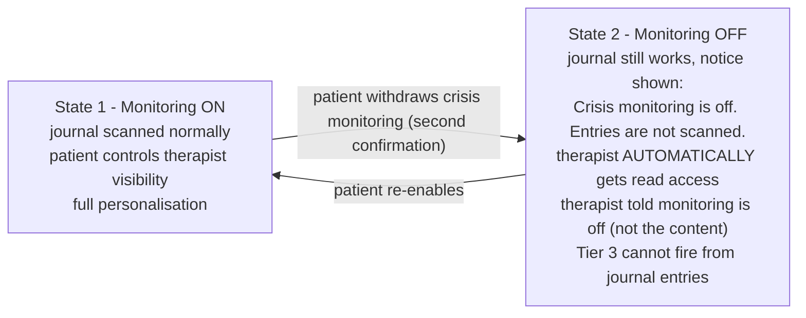

A patient **cannot** have monitoring off *and* the journal hidden from the therapist. Someone always has eyes on the writing — either the AI or the therapist. This is explained at the toggle, not buried in settings.

### 14.4 Data and retention

| Data | Retention |
|---|---|
| Email | Life of account + 30 days after deletion |
| Survey scores | Life of account |
| Mood logs | 12 months rolling |
| Journal entries | Life of account or until the patient deletes |
| Crisis event logs | **24 months** (safety/legal) |
| AI summaries | Regenerated weekly; previous version deleted |
| Therapist messages | Life of account |
| Consent records | Indefinite |
| Therapist licence number | Life of therapist account |
| Safety plan | Life of account or until fields are cleared |

**Purpose limitation** is enforced at the API layer, not just the UI. Mood → personalisation, therapist view, crisis detection only. Journals → patient display, optional therapist view, crisis detection. Survey → placement and therapist view. Crisis logs → safety record and alerts. Safety plan → patient and optional therapist view, **never AI**. Nothing goes to analytics or model training without a separate consent item.

### 14.5 User rights

| Right | How |
|---|---|
| Access / portability | Settings → Privacy → Download My Data (JSON/CSV, secure link, 24h expiry) |
| Rectification | Profile editable; survey results appended on retake; mood logs get a note, not an edit |
| Erasure | Two-step delete; hard delete within 30 days (see below) |
| Restriction | "Pause Data Processing" (read-only mode) |
| Object / withdraw | Per consent item |

### 14.6 Account deletion — what really disappears

A plain-language summary appears **before** deletion completes, and a confirmation email follows with a reference number:

| When | What |
|---|---|
| **Immediately** | Profile, journal entries, mood logs, messages, task history, safety plan, AI summaries; queued notifications cancelled |
| **Within 30 days** | Server backups; AI provider deletion request triggered per the DPA |
| **Kept 24 months** | Crisis event logs (safety and legal) |
| **Kept indefinitely** | Consent records (legal compliance) |

The therapist is told the patient has left, with no reason given.

### 14.7 Transparency tools for the patient

- **Access log** (Settings): *"Your therapist viewed your weekly summary on [date]"* — timestamp and data type only. Read-only, forward-only from launch, cannot be edited by the patient or anyone else.
- **Permission-change confirmations** with timestamps on every privacy change.
- **One notification per AI summary** (not per view).
- **Honesty about limits (Build Note 9):** revoking access stops future viewing but cannot erase what a therapist already saw. Shown at onboarding and again at the moment of revoking: *"Your therapist will lose access going forward. They may retain memory of anything already viewed."* The platform's deletion scope vs what it cannot control is listed in privacy settings.

### 14.8 Optional encrypted backup (Build Note 12)

Because on-device storage means a lost phone can erase months of history:
- **Off by default; explicit opt-in.** Disclosure: *"Your data will be stored encrypted on our servers. It can be recovered if you lose your phone, but a copy will exist outside your device."*
- AES-256, same as local storage.
- **Selective scope:** safety plan and crisis resources (recommended, flagged as most important); mood and task records (optional); journal entries (optional, with a note that some patients prefer them to exist only on device).
- Verified authentication required before restoring to a new device.
- **No silent backup, ever** — the patient always knows if anything is being backed up.

### 14.9 Third-party processors and the AI DPA

| Processor | Data | Key requirement |
|---|---|---|
| AI provider | Journal content or signals, mood signals | See the four guarantees below |
| AWS | All data | Standard DPA; residency options later |
| SendGrid | Therapist email only | Standard DPA |
| SMS provider | Therapist phone + non-identifying alert | Standard DPA |
| Error monitoring (Sentry or equivalent) | Error logs | Must scrub PII/health data before it leaves the infrastructure |

**Before any real patient data reaches the AI provider, the DPA must guarantee:** (1) no retention of input data, (2) no model training on inputs, (3) no human review of inputs, (4) deletion on contract termination.
- Prefer sending **sentiment signals over full journal text** where technically possible (minimum transmission).
- A **named fallback provider** must be ready before launch in case the primary cannot sign.
- Review the DPA **every six months**, alongside therapist re-verification.
- Data Sharing Agreement for therapists (partial controllers) is separate from the ToS.

### 14.10 Breach protocol

Server-side anomaly monitoring (bulk exports, new-IP access); first 24 hours: scope, contain, assess; **72-hour** notification to the supervisory authority; users told without undue delay when risk is high, in plain language; every breach logged.

---

## 15. Security and authentication

- **Self-hosted JWT** (no third-party auth provider): access token 15 min; refresh token 30 days, rotated on use.
- **Therapist MFA:** optional but **strongly encouraged**, with a dismissible banner that returns periodically until enabled (mandatory MFA at signup was judged too much friction because therapists arrive through a patient invite).
- **Required regardless of MFA:** login alerts and session revocation.
- **Re-authentication:** if a therapist session is older than **4 hours** when a crisis alert is opened, re-authenticate first.
- **Encryption:** AES-256 at rest (server and device); TLS 1.3 in transit. Mandatory from day one, never retrofitted.
- **Access control** enforced at the API, not the UI. Pseudonymised analytics and error logs.
- **Post-quantum encryption** (e.g. CRYSTALS-Kyber) is flagged for future EU expansion — not a day-one requirement.

---

## 16. Technology stack

| Layer | Choice |
|---|---|
| Patient app | **Flutter**, Android first (iOS next, desktop later). Dart. |
| Therapist web | Next.js (App Router), TypeScript, Tailwind, shadcn/ui — server-rendered for patient summaries and alerts |
| Backend | **Node.js 22 + NestJS** (chosen over Fastify for enforced structure in a compliance-heavy codebase); REST + WebSockets |
| Database | PostgreSQL + Prisma; journals encrypted at rest in Postgres (not S3) |
| Cache/queues | Redis — sessions, notification queues, **crisis escalation timers**, AI rate limits |
| AI | Groq → Cerebras → OpenRouter (Mistral), backend only |
| Notifications | FCM (mobile), Web Push (therapist browser), SendGrid (email), SMS provider |
| Hosting | AWS: ECS (Docker), RDS, ElastiCache, S3, CloudWatch |
| Deployment | Monolith with clean module separation; no Kubernetes or microservices at launch |

**AI call types:** crisis detection (every journal save, sub-2s, dedicated endpoint) · task selection (daily) · journal sentiment (background, batched) · therapist summary (weekly) · message drafts (on demand).

---

## 17. Information architecture

**Patient side**
- *Pre-auth:* splash, sign up, log in, password reset
- *Onboarding:* see 6.1
- *Home:* greeting, mood check-in, Today's Focus, weekly snapshot, therapist panel, crisis button, Day-1 safety-plan card
- *Task:* detail, "Why this task?", optional supplementary task, "I need something different today", Friday task and reflection
- *Journals:* Recovery Journal, Personal Journal, past entries, privacy indicator
- *History:* 30-day mood, task history (detail locked at Level 2)
- *Roadmap:* current stage (internal), upcoming tasks (locked at Level 2)
- *Therapist connection:* status, invite (email or code), thread, unlock transition
- *Safety plan:* intro card, creation, edit, read-only on crisis screen
- *Crisis flow:* persistent button → hotlines, safety plan card, grounding; Tier 1/2/3 behaviours; offline route
- *Settings:* profile, notifications, privacy setting, safety plan, privacy and data rights, access log, backup, crisis consent, persistent "wellness companion, not a clinical service" note, log out/delete

**Therapist side**
- Pre-auth, onboarding, dashboard (priority groups), individual patient view, messaging with AI draft, stage advancement (48h hold), crisis alert view, AI alert feed, task suggestion review, settings (credentials, notifications, communication style, response time)

**Shared:** authentication, offline mode, always-accessible crisis resources.

---

## 18. Success measures and evidence gates

Usage is not value. Check-ins and completed tasks show the app was *used*, not that it *helped*.

**Outcome questions (added to existing flows, no new screens)**
- **Onboarding baseline:** one outcome question, asked once.
- **Weekly reflection (2 questions):** *"How equipped did you feel managing time between sessions this week?"* and *"Would you notice if the app wasn't there?"*
- **After every completed task:** one tap — *"Did this help?"*

**Evidence gate:** after the first real cohort, if weekly outcome scores trend upward **and** most users say they would notice the app's absence, that justifies building the therapist dashboard and later systems.

**Conditional-issue triggers to watch in testing**

| Area | Becomes a real problem if… |
|---|---|
| Home screen | Testers can't name the main action or find the crisis button in 10 seconds |
| Daily task | Swap requests or skips are consistently high |
| Safety plan | Start-to-save completion is low and drafts never become usable plans |
| Deletion | Support requests, distrust or full-account deletion appear because contents can't be cleared confidently |
| Reminders | Opt-outs, uninstalls or reminder-related distress rise despite the limits |
| Access requests | Consent behaviour changes or journal honesty/use drops after requests |
| Messaging | Patients rely on it for urgent help |
| Friday | Friday usefulness or return rates are consistently lower |
| New categories | Skips or distress rise specifically after unfamiliar activities |
| Reconnection stage | Users find no safe route to social support and retention suffers |

---

## 19. Build plan and gates

**Timeline:** two months, vibe-coded. The risk is not whether the team can ship — it is **demoing with unresolved safety or trust issues** that mentors or judges will catch.

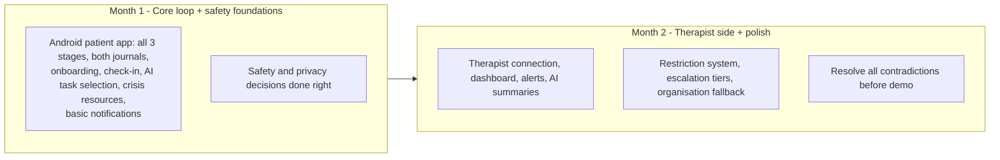

**First technical milestone:** a small, testable **safety flow on Android** — not the full collection of screens and platforms.

### Build gates

A gate must be fully resolved before the features behind it handle real patient data.

| Gate | Items | Topic |
|---|---|---|
| **1 — Safety behaviour** | B01, B02, B04, B05 | Alert lifecycle, AI failure mode, offline alerts, consent transitions |
| **2 — Identity and data protection** | B06, B07, B08 | Therapist verification, AI logging, account security |
| **3 — Architecture and launch claims** | B03, B09, B10 | Provider decision, legal classification, release scope |

Gate 1 decisions should be reviewed with a clinical consultant before build begins.

---

## 20. Regulatory position and business model

**Regulatory.** The working position is that the AI is **decision-support, not a medical device**. A product cannot settle its own regulatory classification, so this is an **assumption pending external review** (Section 22). Pre-launch checklist: DPAs signed with all processors; data sharing agreement for therapists; breach protocol documented; crisis-log retention policy documented.

**Business model.** Entirely free at launch. **No ads — permanent.** Post-MVP hybrid: **free for patients, always; charge institutions** (clinics, therapy practices, mental health organisations) for therapist-dashboard and multi-patient features. *"Free for patients, always. We charge the institutions that employ or refer therapists."* Pricing tiers, institutional onboarding and billing are post-MVP. A therapist incentive for adopting the tool is **not yet answered** (Issue 05).

---

## 21. Permanent decisions

Do not reopen without a strong reason.

| Decision | Choice |
|---|---|
| Standalone vs companion | Companion only — never a replacement for therapy |
| Primary age range | 18–35; under 18 blocked at launch |
| Peer support | Ruled out permanently — moderation and safety liability too high |
| Advertising | Never |
| Marketplace behaviour | Out of scope permanently — no filtering, matching or contact facilitation |
| Level 3 fallback | Basic organisation numbers only |
| Safety plan and AI | None — AI never touches it |
| Safety plan Field 4 | Always private |
| Device safeguarding | First-build: discreet notifications, biometric lock, fast exit |
| Disconnection | Patient-only |
| Backups | No silent backup, ever |
| AI provider | Never OpenAI; backend-only calls |
| Encryption | AES-256 at rest and TLS 1.3 in transit, mandatory |
| Notification voices | Warm to patients, direct to therapists — never mixed |
| Offline safe core | Grounding and crisis resources need no login |
| Journals | Two separate journals: Recovery (stage-gated) and Personal (always private) |

---

## 22. Open items and unresolved conflicts

### 22.1 Awaiting external input

| Issue | Question | Who |
|---|---|---|
| **05** | What makes a therapist say yes (incentive, pricing, billing)? | Mentor |
| **24** | Confirm the **named clinical reviewer**; set sign-off scope and removal process | Bangladeshi licensed therapist |
| **25** | Survey translation into Bangla, cultural reframing of recovery concepts, help-seeking assumptions, mixed Bangla/English use | Therapist + mentor (bundle with Issue 24 — ideally the same therapist) |
| **27** | Does the feature set need external regulatory review? Which Bangladesh digital-health rules apply? Which features are at risk if classification changes? | Mentor |
| **28** | Does the "platform owns the safety net" model (Option C) adequately limit therapist negligence exposure? | Mentor |

### 22.2 Conflicts between source documents (need a team decision)

| # | Conflict | What this spec assumed |
|---|---|---|
| 1 | **Offline freshness window:** B04 says 6 hours; Build Note 6 says 2 hours. | **2 hours** (the later note). Confirm. |
| 2 | **Invite expiry:** B06 says 72 hours; Build Note 3 says 48 hours. | **48 hours** (the later note). Confirm. |
| 3 | **Minimum age:** original onboarding says 16+; Issue 23 sets 18–35 with under-18 blocked. | **18+**. Update the signup text and minors policy. |
| 4 | **Personal Journal scanning:** "no AI analysis" (Issue 16) vs "always watches for safety signals regardless of privacy setting" (Issues 17/18). | Unresolved — decide whether safety-signal scanning covers the Personal Journal and word the promise exactly. |
| 5 | **Escalation notification copy:** therapist copy says an unreviewed Tier 2 alert escalates to emergency contacts at 2 hours; the timer escalates to organisations at 6 hours. | Align copy with the timer, and confirm which tiers trigger the 6-hour organisation SMS. |

### 22.3 Still to be defined during build

- The **"no recent activity"** threshold (X days) for therapists' unknown-status group.
- The exact **MVP therapist feature cut line** (Issue 09).
- The **14–21 day** pause cap — pick one number.
- Confirmation that each emergency organisation accepts **inbound SMS**.
- A **named fallback AI provider** with a signable DPA, and a signed DPA with the primary.
- **Conditional issues (30–39)** are designed but only proven by real testing (Section 18).
- **Post-MVP:** verified-organisation unlock path (Issue 04), full therapist dashboard (Issue 09), severe-user support (Issue 22), iOS and desktop (B10).

---

*Compiled from team discussion sessions. Not a clinical or legal conclusion. Consult the mentor and a licensed therapist before closing the open items above.*
